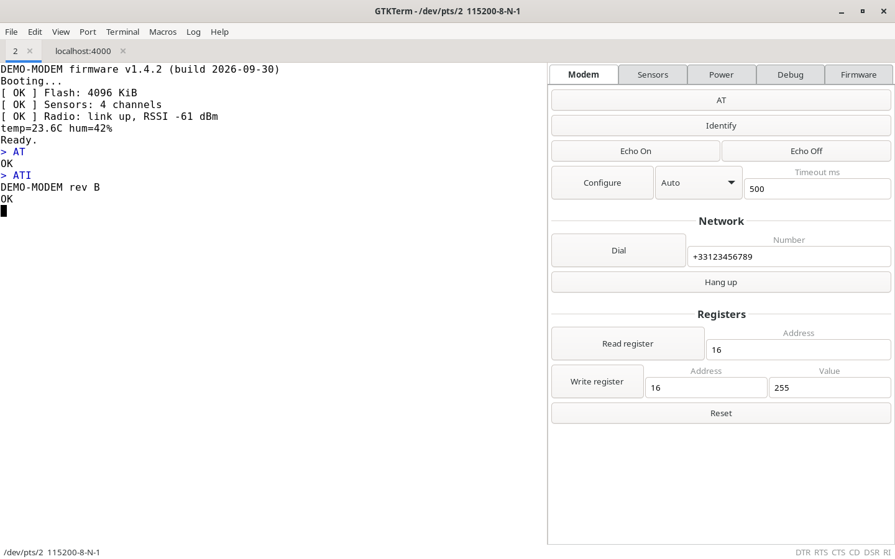
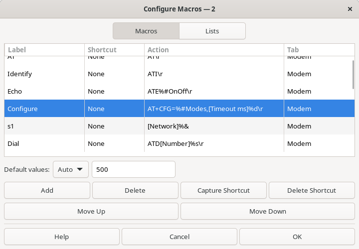
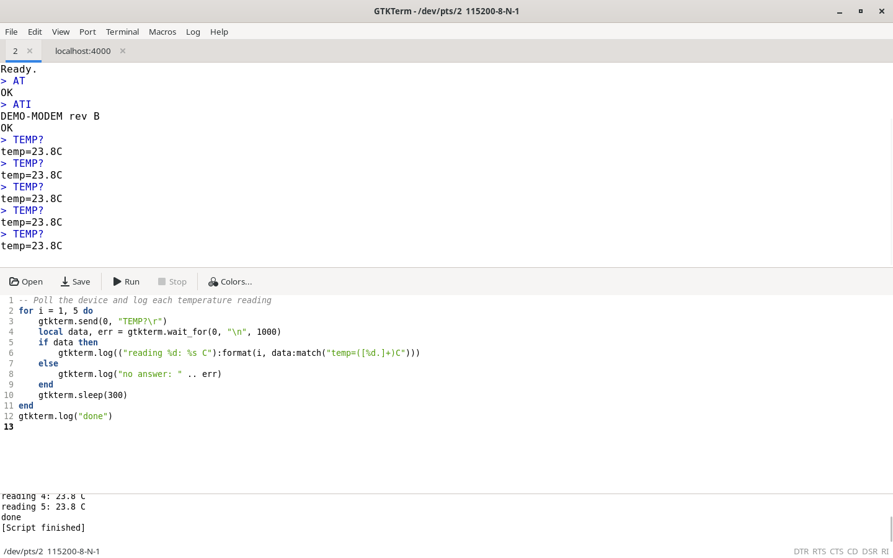
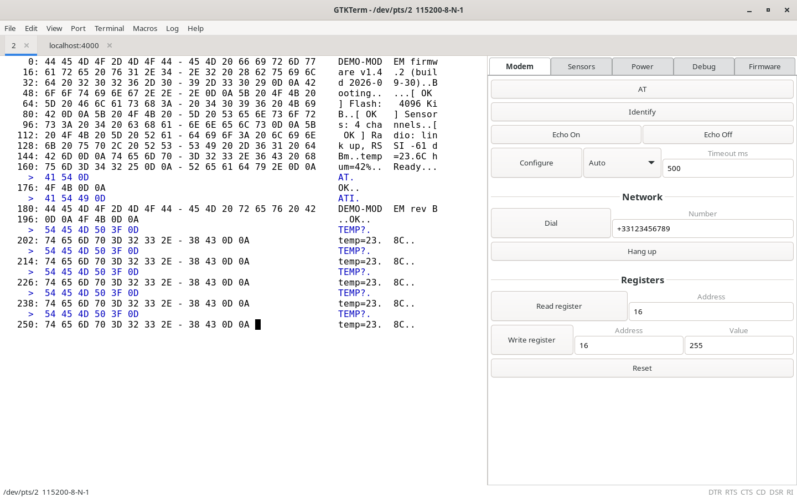

<p align="center">
  
</p>

<h1 align="center">GTKTerm</h1>

<p align="center">
  <b>A serial and TCP terminal for Linux, built for people who talk to devices all day.</b><br/>
  Tabs, projects, a macro panel with arguments, and Lua scripting, on GTK 4.
</p>

<p align="center">
  <a href="https://github.com/Mula-Gabriel/gtkterm/tags"></a>
  
  
  
  <a href="COPYING"></a>
</p>

<p align="center">
  
</p>

GTKTerm talks to anything with a serial line: embedded boards, microcontrollers, modems, GPS receivers, CNC machines, test benches. This fork of the classic
GTKTerm adds everything a daily bench workflow asks for: one tab per port, a whole workstation saved in one project file, buttons for your commands (with
fields, drop-down lists and periodic sending), a Lua engine to automate exchanges, TCP client and server links, and updates from inside the application.

## ✨ Highlights

<table>
<tr>
<td width="50%" valign="top">

**🗂️ Tabs**<br/>
One port per tab, each a complete session: its own link, options, profile, macros, script, log and file transfer. Drag tabs to reorder them.

</td>
<td width="50%" valign="top">

**📦 Projects**<br/>
A single `.gtkterm` file holds every tab with its port, settings, macros and script. Send it to a colleague: the whole workstation comes with it.

</td>
</tr>
<tr>
<td valign="top">

**🎛️ Macro panel**<br/>
Buttons grouped in tabs, printf-style arguments (`%d`, `%s`, `%x`…), drop-down lists, labelled fields, section separators, keyboard shortcuts and
periodic sending (polling).

</td>
<td valign="top">

**🧩 Lua scripting**<br/>
A built-in editor and console. Scripts send, wait for answers, open up to 15 extra serial or TCP ports, trigger macros and write CSV files, in a
background thread that never freezes the window.

</td>
</tr>
<tr>
<td valign="top">

**🌐 Serial and TCP**<br/>
Serial ports, TCP client and TCP server, with silent auto-reconnect: unplug the adapter, plug it back, the tab picks up where it left off.

</td>
<td valign="top">

**🔄 Built-in updates**<br/>
Help › Check for updates… lists the published versions with their release notes, installs one in a single step, and can roll back just as easily.

</td>
</tr>
</table>

## 📥 Installation

### Build from source

GTKTerm needs GTK 4 (≥ 4.14), VTE for GTK 4 (≥ 0.76), GtkSourceView 5 (≥ 5.12), libgudev, Lua 5.4 and GLib ≥ 2.70. Ubuntu 24.04 provides all of them:

```sh
sudo apt install libgtk-4-dev libvte-2.91-gtk4-dev libgtksourceview-5-dev libgudev-1.0-dev liblua5.4-dev meson ninja-build git
git clone https://github.com/Mula-Gabriel/gtkterm.git
cd gtkterm
meson setup build
ninja -C build
sudo meson install -C build --no-rebuild
```

`--no-rebuild` keeps root from rebuilding (and from leaving root-owned files in `build/`). The default prefix is `/usr/local`; use
`meson setup build -Dprefix=/usr` to install elsewhere.

### Stay up to date

Open **Help › Check for updates…**. GTKTerm lists the published versions (git tags `vX.Y.Z`), shows what changed between yours and the one you pick, with
any warnings first, and installs it with **Update to vX.Y.Z**. It asks for your password once, rebuilds and restarts GTKTerm. **Roll back to vX.Y.Z** works
the same way. A newer version is also announced at start-up; **Skip this version** silences it until the next one.

> [!NOTE]
> Coming from a GTK 3 build of GTKTerm? The launcher is now `eu.mulagabriel.gtkterm.desktop`. The updater removes the old `gtkterm.desktop`; after a manual
> `sudo meson install` over a GTK 3 installation, remove `<prefix>/share/applications/gtkterm.desktop` by hand.

### Uninstall

```sh
sudo ninja -C build uninstall
```

If the `build` directory is gone, build again with the same `-Dprefix`, then uninstall.

## 🚀 Using GTKTerm

### Tabs

**Port › New port…** (`Ctrl+Shift+T`) opens the port dialog pre-filled with the active tab's settings, for a serial port, a TCP client or a TCP server.
Each tab keeps its own link, history, options (echo, CR/LF, timestamps, view), macros, script panel, log and file transfer; a polling macro keeps sending
on its own port while another tab is shown. The tab bar appears from two tabs, each tab showing the activity of its port (see below). Closing a
tab (`Ctrl+Shift+W`) asks for confirmation only when a script is running or a file is being sent. The same serial port cannot be opened in two tabs
(unless `--disable-port-lock`).

### Port activity

A small indicator left of each tab name (in the status bar when only one tab is open) shows the state of the tab's port at a glance:

- hollow dot: open, waiting for data or data received recently; **green dot**: receiving; **red dot**: connection lost;
- spinner: connecting (TCP client, or TCP server waiting for a client), red while reconnecting;
- **Zzz**: idle, data was received then nothing for the *idle* delay; **skull** and greyed name: no data at all for the *no data* delay since the port
  opened, or reconnection failing for that long;
- a tab that receives data while it is not shown has its name in bold until you show it.

Both delays are per profile, in the port dialog › **Advanced Configuration Options › Port activity** (defaults 10 s and 60 s, 0 disables the state).

### Reconnecting after an unplug or a suspend

With **Port › Autoreconnect**, a lost port is reopened silently as soon as the device is back. A USB-serial adapter (`ttyUSB…`) can come back under
another name when it disappears while the port is open, after an unplug or a suspend (`ttyUSB0` becomes `ttyUSB1`). To always find it, type its stable
name in the port dialog: `/dev/serial/by-id/…` (one name per adapter, from its serial number) or `/dev/serial/by-path/…` (one name per USB socket, for
identical adapters). `ttyACM…` devices and built-in `ttyS…` ports keep their name. TCP links are checked by keepalive: a peer that vanishes without
closing the connection (asleep, unplugged, switched off) is reported lost after about one minute of silence.

### Projects

A project is one `.gtkterm` file holding a whole workstation: every tab with its port and terminal settings, its page layout, **a copy** of its macros and
**a copy** of its Lua script. Nothing in it points to another file, unless you link a macros template (below).

| Action | What it does |
|---|---|
| **File › New project** | One tab with the `default` profile, no macros, no script. |
| **File › Open project…** (`Ctrl+Shift+O`) | Replaces all the tabs with the project's and opens their ports. A damaged or newer file is refused as a whole and nothing is closed. |
| **File › Save project** / **Save project as…** | Saving is always explicit; the title shows `name •` while there are unsaved changes. |
| **File › Close project** | Back to a single ordinary tab. |

GTKTerm reopens the last project at start-up (unless the command line gives a profile or port settings), and `gtkterm --project FILE` opens a given one.
Before writing over a project or macros file that someone else changed on disk, GTKTerm asks **Overwrite / Reload / Cancel**, with Cancel as the default.

**Macros templates.** In a project tab, **Macros › Load macros file…** asks whether to **copy** the file into the project or **link** it as a template
shared by several projects. A linked tab keeps its own default values and polling settings in the project; when you change macros in Configure macros,
GTKTerm asks whether to keep the new default values in this project or save them to the template (renaming, adding or removing macros can only go to the
template, or the tab can be detached and keep its own copy). The template is re-read each time the project opens, your project values are applied on top,
and other tabs linked to it are refreshed when you save it. **Macros › Detach from template** turns the tab back into a plain copy.

Without a project, tabs work with named profiles (Port › Load / Save / Delete profile…, stored in `~/.config/.gtktermrc`) and one macros file (`.ini`) per
tab.

### Macro panel

Toggle it with **View › Macro panel** and fill it in **Macros › Configure macros…**. Each macro has a label, an optional keyboard shortcut, an action
(the text to send, with `\r`, `\n`, `\xNN` escapes) and an optional tab name to group buttons.

<p align="center">
  
</p>

| In the action | In the panel |
|---|---|
| `AT+SEND=%s\r` | a button and a text field |
| `RD [Address]%u\r` | a field labelled « Address » |
| `CH %#Channels\r` | a drop-down list of the `Channels` list (Macros › Lists tab) |
| `ATE%#OnOff\r` with a two-entry list | two buttons, « Echo On » and « Echo Off » |
| `[Network]%&` | a section separator titled « Network » (`%&` alone: a plain line) |

- **Arguments**: what you type in the panel is used for sending but never saved. An empty field sends the argument's **default value**, shown greyed
  in it; right-click a button › **Reset arguments** empties the fields. Hover a field to see what it accepts (« integer, 0 – 100 (default 50) »).
- **Argument table**: selecting a macro in Configure macros shows one row per argument: its specifier, type, default value and optional limits:
  minimum and maximum for numbers; for `%s`, a length in **bytes sent** and a character set: UTF-8 (any), Printable ASCII, ASCII,
  8 bits (Latin-1, **sent as one byte per character**) or a custom class such as `A-Z0-9_-`. Below it, the **line sent** with the default values:
  arguments in blue (red when invalid), escapes and control characters in purple (`CR`, `LF`, `\xHH`…), then the bytes in hexadecimal.
- **Out of limits**: a field that breaks its limits turns red and the macro is **not sent** (click, shortcut, polling or Lua `send_macro`, which
  returns `false, "invalid argument"`); the status bar says which argument and why.
- **Polling**: right-click a button › **Polling Mode** and a period in milliseconds. The button gets a ⏱ prefix; a click starts or stops the periodic
  sending, and the button blinks while it runs.
- **Tabs**: macros with no tab name go to **General**; right-click the tab bar to show or hide each group.

<details>
<summary><b>All format specifiers</b></summary>

| Specifier | Type |
|---|---|
| `%s` | string |
| `%c` | single character |
| `%d` `%i` (with `hh`, `h`, `l`, `ll`) | signed integer |
| `%u` `%o` `%x` `%X` (with `hh`, `h`, `l`, `ll`) | unsigned integer: decimal, octal, hexadecimal |
| `%f` `%e` `%g` `%a` (and `F` `E` `G` `A`) | float, about 9 significant digits |
| `%lf` `%le` `%lg` `%la` | double, about 16 significant digits |
| `%Lf` `%Le` `%Lg` `%La` | long double, about 19 significant digits |
| `%#Name` | value picked from the list `Name` |
| `[Label]` before any of them | label shown above the field |

Values are checked as you type (an invalid field turns red) and truncated to the type's precision when sent.

</details>

### Lua scripting

**View › Script panel** opens an editor (syntax highlighting, configurable colours) and a console. **Run** starts the script in a background thread;
**Stop** interrupts it at once, even inside a loop. Port `0` is the tab's own port; ports `1` to `15` are extra serial or TCP ports opened by the script.

<p align="center">
  
</p>

| Function | Description |
|---|---|
| `gtkterm.send(port, data)` / `gtkterm.send_hex(port, "01 A0 FF")` | Send bytes; returns `true`, or `false` and a reason. |
| `gtkterm.wait_for(port, text [, timeout_ms])` | Wait until `text` is received; returns the data up to and including it, or `nil` and `"timeout"` / `"closed"`. |
| `gtkterm.read(port)` / `gtkterm.clear(port)` | Take everything received so far / discard it. |
| `gtkterm.open(port, "serial", device [, baud, bits, stop, parity, flow])` | Open an extra serial port (`port` 1–15). |
| `gtkterm.open(port, "tcp_client", host, tcp_port [, timeout_ms])` | Connect to a TCP server. |
| `gtkterm.open(port, "tcp_server", tcp_port [, host])` | Listen for one TCP client. |
| `gtkterm.close(port)` / `gtkterm.status(port)` | Close a port / get its state (`"open"`, `"closed"`, `"lost"`…). |
| `gtkterm.send_macro(index_or_label [, args…])` | Send a macro of the tab. |
| `gtkterm.get_macros()` / `gtkterm.get_lists()` | The tab's macros (with their arguments) and value lists. |
| `gtkterm.sleep(ms)` / `gtkterm.time()` | Pause / seconds from a monotonic clock. |
| `gtkterm.log(text)` / `print(…)` | Write to the console. |
| `gtkterm.save_csv(file, values…)` | Append one comma-separated line to a file. |

Eleven commented examples live in [`scripts/`](scripts): AT commands, `wait_for`, CSV logging, macros, a binary protocol, TCP client and server, several
ports at once, a firmware update.

### Views, logging and files

<p align="center">
  
</p>

- **View**: ASCII or hexadecimal (8 to 32 bytes per line, optional index); **View › Send hexadecimal data** opens a bar to type bytes. Switching view,
  echo, CR/LF or timestamps redraws the whole history: nothing received is lost.
- **Terminal**: local echo, CR LF auto, ESC clears the screen, timestamps; **Terminal › Settings…** for the font, colours, cursor and scrollback.
- **Log › To file…** records everything received (with pause, stop and clear); **File › Save RAW / ASCII file…** saves the history;
  **File › Send RAW file…** sends a file, with an optional delay or a wait for a character at each end of line.

### Keyboard shortcuts

GTKTerm keeps every plain `Ctrl+letter` for the port (`Ctrl+C`, `Ctrl+B`, `Ctrl+Z`… are sent to the device), so its own commands use `Ctrl+Shift`.

| Keys | Action | Keys | Action |
|---|---|---|---|
| `Ctrl+Shift+T` | New port (new tab) | `Ctrl+Shift+C` | Copy |
| `Ctrl+Shift+W` | Close tab | `Ctrl+Shift+V` | Paste |
| `Ctrl+Shift+Page Down` / `Page Up` | Next / previous tab | `Ctrl+Shift+A` | Select all |
| `Ctrl+Shift+O` | Open project | `Ctrl+Shift+F` | Find |
| `Ctrl+Shift+S` | Port settings | `Ctrl+Shift+L` | Clear screen |
| `Ctrl+Shift+R` | Send file | `Ctrl+Shift+K` | Clear scrollback |
| `Ctrl+Shift+B` | Send break | `Ctrl+Shift+Q` | Quit |
| `F5` / `F6` | Open / close port | `F7` / `F8` | Toggle DTR / RTS |

### Command line

```sh
gtkterm --port /dev/ttyUSB0 --speed 115200        # serial port
gtkterm -T tcp-client --host 192.168.1.20 -P 4000  # TCP client
gtkterm -T tcp-server -P 4000                      # TCP server
gtkterm -c bench                                   # saved profile « bench »
gtkterm --project ~/bench.gtkterm                  # project
```

`gtkterm --help` (or `man gtkterm`) lists every option: bits, parity, stop bits, flow control (including RS-485), end-of-line delay, port lock.

### Scripting from the shell

Some boards are flashed through the same serial line that prints their debug output. GTKTerm releases and takes back the port on signals, for every tab:

| Signal | Action | Example |
|---|---|---|
| `SIGUSR1` | Open the ports | `killall -USR1 gtkterm` |
| `SIGUSR2` | Close the ports | `killall -USR2 gtkterm` |

> [!NOTE]
> RS-485 flow control is emulated in user space and may not switch fast enough for every setup; use an RS-232 to RS-485 converter or a kernel driver if
> it does not.

## 🛠️ Development

```sh
meson setup build && ninja -C build
meson test -C build                 # unit and integration tests
meson test -C build --suite gui     # GTK 4 interface scenarios, on a private display (never your screen)
```

The code is split into three layers: a GLib-only core, an application layer and the GTK 4 interface. See [`CLAUDE.md`](CLAUDE.md) for the architecture,
[`tests/README.md`](tests/README.md) for the test harness and [`NEWS`](NEWS) for the history of versions.

## 📜 License

Original code by Julien Schmitt; this fork adds tabs, projects, macros, Lua scripting, TCP transport and the GTK 4 interface.

    This program is free software: you can redistribute it and/or modify
    it under the terms of the GNU General Public License as published by
    the Free Software Foundation, either version 3 of the License, or
    (at your option) any later version.

    This program is distributed in the hope that it will be useful,
    but WITHOUT ANY WARRANTY; without even the implied warranty of
    MERCHANTABILITY or FITNESS FOR A PARTICULAR PURPOSE.  See the
    GNU General Public License for more details.

    You should have received a copy of the GNU General Public License
    along with this program.  If not, see <http://www.gnu.org/licenses/>.
